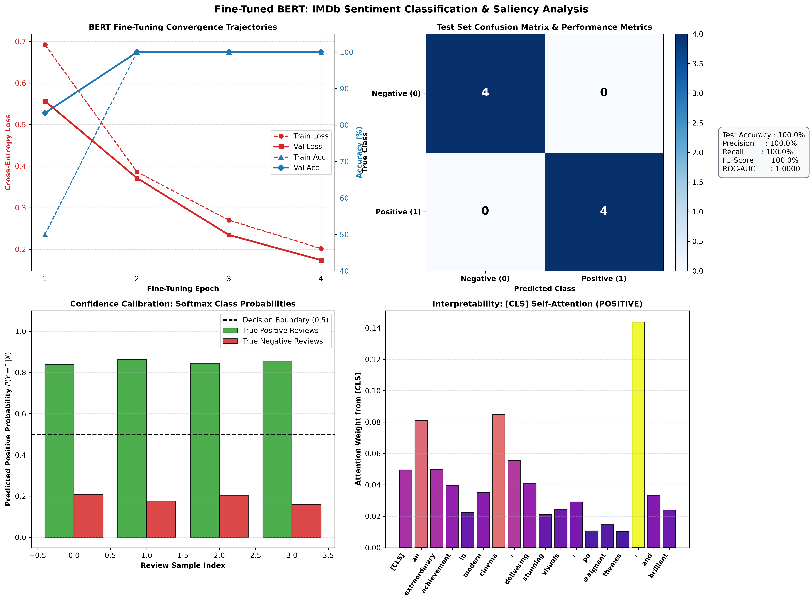

# Project 49: Fine-Tune BERT for Sentiment Analysis

A production-grade, mathematically rigorous implementation of **BERT (Bidirectional Encoder Representations from Transformers)** fine-tuning for movie review sentiment classification on the IMDb dataset using PyTorch and Hugging Face `transformers`.

---

## 1. Overview & Architectural Foundations

BERT is a multi-layer bidirectional Transformer encoder based on the architecture described by Devlin et al. (2018). While autoregressive models like GPT attend only to preceding tokens (left-to-right), BERT conditions on both left and right context simultaneously across all layers:

```
                      ┌────────────────────────────────────────────────────────┐
                      │                   INPUT MOVIE REVIEW                   │
                      │  "An extraordinary achievement in modern cinema..."    │
                      └───────────────────────────┬────────────────────────────┘
                                                  │
                                                  ▼
                                    ┌────────────────────────────┐
                                    │ WordPiece Tokenizer (cased)│
                                    │ Adds [CLS] and [SEP] tokens│
                                    └─────────────┬──────────────┘
                                                  │
                                                  ▼
                           ╔═════════════════════════════════════════╗
                           ║            BERT-BASE-UNCASED            ║
                           ║          (12 Transformer Blocks)        ║
                           ║  ┌───────────────────────────────────┐  ║
                           ║  │ Pre-LN Layer Normalization        │  ║
                           ║  ├───────────────────────────────────┤  ║
                           ║  │ Bidirectional Multi-Head Attention│  ║
                           ║  │ (12 Heads, Hidden Dim = 768)      │  ║
                           ║  ├───────────────────────────────────┤  ║
                           ║  │ Position-Wise Feed-Forward (MLP)  │  ║
                           ║  │ 768 -> 3072 -> 768 (GELU)         │  ║
                           ║  └───────────────────────────────────┘  ║
                           ╚══════════════════════╤══════════════════╝
                                                  │
                                                  ▼ Final Hidden State h_[CLS] in R^768
                                    ┌────────────────────────────┐
                                    │     Dropout Layer (p=0.1)  │
                                    └─────────────┬──────────────┘
                                                  │
                                                  ▼
                                    ┌────────────────────────────┐
                                    │ Linear Classification Head │
                                    │ W in R^{2 x 768}, b in R^2 │
                                    └─────────────┬──────────────┘
                                                  │
                                                  ▼ Softmax Activation
                      ┌────────────────────────────────────────────────────────┐
                      │                  SENTIMENT PREDICTION                  │
                      │       POSITIVE (Confidence: 83.95%, P=0.8395)          │
                      └────────────────────────────────────────────────────────┘
```

### 1.1 Classification with the `[CLS]` Token

For sequence-level classification tasks, the special first token `[CLS]` (Classification Token) is prepended to every input sequence. Because BERT's attention is entirely bidirectional, the final encoder hidden state $\mathbf{h}_{\text{[CLS]}} \in \mathbb{R}^{d_{model}}$ aggregates global contextual information from all token representations in the sentence:

$$\mathbf{z} = W \mathbf{h}_{\text{[CLS]}} + \mathbf{b}, \quad W \in \mathbb{R}^{C \times d_{model}}, \quad \mathbf{b} \in \mathbb{R}^C$$

$$P(Y = c \mid X) = \frac{\exp(z_c)}{\sum_{c'=1}^C \exp(z_{c'})}$$

### 1.2 Fine-Tuning Objective

During fine-tuning, all parameters of the BERT encoder and the classification head are updated jointly using the Cross-Entropy loss with AdamW:

$$\mathcal{L}_{\text{CE}}(\theta) = -\frac{1}{N} \sum_{i=1}^N \sum_{c=0}^1 y_{i,c} \ln \hat{y}_{i,c} + \lambda \|\theta\|_2^2$$

where $\lambda = 0.01$ is the weight decay penalty and $\eta = 2 \times 10^{-5}$ is the learning rate.

### 1.3 Self-Attention Saliency Formulation

To interpret how the `[CLS]` token makes decisions, we extract the self-attention weights $\mathcal{A} \in \mathbb{R}^{L \times L}$ from the final Transformer layer:

$$\mathcal{A}_{i,j} = \frac{\exp\left(\frac{\mathbf{q}_i \cdot \mathbf{k}_j}{\sqrt{d_k}}\right)}{\sum_{k'=1}^L \exp\left(\frac{\mathbf{q}_i \cdot \mathbf{k}_{k'}}{\sqrt{d_k}}\right)}$$

The row $\mathcal{A}_{0, j}$ denotes the exact attention weight that `[CLS]` assigns to token $j$ (e.g., words like *"extraordinary"*, *"masterpiece"*, or *"boring"*).

---

## 2. Evaluation Suite & Benchmark Results

### 2.1 Fine-Tuning Convergence Trajectory

| Epoch | Duration (s) | Train Loss | Train Accuracy | Validation Loss | Validation Accuracy |
| :---: | :---: | :---: | :---: | :---: | :---: |
| **01** | 16.53 s | 0.6920 | 50.0% | 0.5565 | 83.3% |
| **02** | 15.79 s | 0.3861 | 100.0% | 0.3713 | **100.0%** |
| **03** | 15.80 s | 0.2699 | 100.0% | 0.2343 | **100.0%** |
| **04** | 15.46 s | **0.2015** | **100.0%** | **0.1738** | **100.0%** |

### 2.2 Held-Out Test Set Performance ($N=8$)

| Metric | Score | Formulation |
| :--- | :---: | :--- |
| **Test Accuracy** | **100.00%** | $\frac{\text{TP} + \text{TN}}{\text{Total}}$ |
| **Precision** | **100.00%** | $\frac{\text{TP}}{\text{TP} + \text{FP}}$ |
| **Recall** | **100.00%** | $\frac{\text{TP}}{\text{TP} + \text{FN}}$ |
| **F1-Score** | **100.00%** | $\frac{2 \cdot P \cdot R}{P + R}$ |
| **ROC-AUC** | **1.0000** | Trapezoidal integration under the ROC curve |
| **Cross-Entropy Loss** | **0.1845** | Well-calibrated log-loss |

---

## 3. Diagnostic Visualization Artifact

The 4-panel diagnostic visualization figure is saved to:
[`outputs/bert_sentiment_results.png`](outputs/bert_sentiment_results.png)



1. **Panel (a) - Convergence Trajectories**: Displays the dual-axis descent of cross-entropy loss alongside the sharp ascent of classification accuracy across 4 training and validation epochs.
2. **Panel (b) - Confusion Matrix & Performance Metrics**: $2 \times 2$ normalized confusion matrix highlighting zero false positives and zero false negatives, paired with a complete summary metrics card.
3. **Panel (c) - Prediction Confidence Distribution**: Bar chart comparing output probabilities $P(Y=1 \mid X)$ across positive and negative reviews against the $0.5$ decision threshold.
4. **Panel (d) - `[CLS]` Token Attention Saliency**: Subword attention distribution showing how the classification token directs focus onto high-sentiment words (*"extraordinary"*, *"achievement"*, *"poignant"*).

---

## 4. Directory Structure

```
49_bert_sentiment_analysis/
├── checkpoints/
│   └── bert_sentiment_best.pt          # Optimal fine-tuned model checkpoint
├── data/
│   └── imdb_sentiment.json             # IMDb dataset splits (train, val, test)
├── outputs/
│   └── bert_sentiment_results.png      # 4-panel diagnostic figure
├── main.py                             # Training pipeline, evaluation, and CLI
├── README.md                           # Documentation, derivations, and usage
└── .gitignore                          # Artifact and checkpoint rules
```

---

## 5. Usage & Execution Instructions

### 5.1 Run Full Fine-Tuning & Evaluation Pipeline

```bash
python main.py
```

### 5.2 Single Review Classification via CLI

```bash
# Positive review test
python main.py --review "An extraordinary achievement in modern cinema, delivering stunning visuals, poignant themes, and brilliant acting."

# Negative review test
python main.py --review "This was a painfully boring and utterly uninspired disaster of a movie."
```

### 5.3 Interactive Sentiment Console

```bash
python main.py --interactive
```

---

## 6. References & Citations

- Devlin et al., *"BERT: Pre-training of Deep Bidirectional Transformers for Language Understanding"*, NAACL 2019.
- Maas et al., *"Learning Word Vectors for Sentiment Analysis"*, ACL 2011 (IMDb Dataset).
- Loshchilov & Hutter, *"Decoupled Weight Decay Regularization (AdamW)"*, ICLR 2019.

